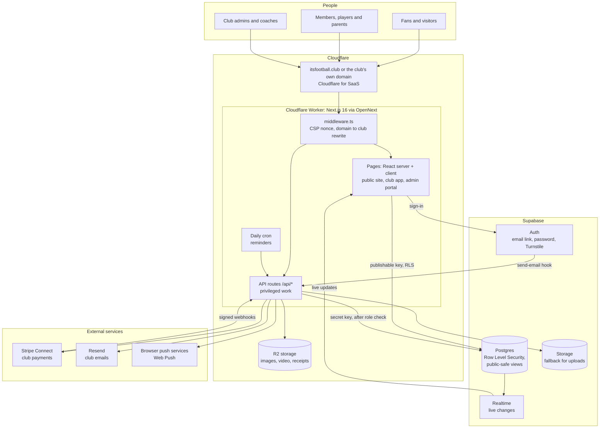
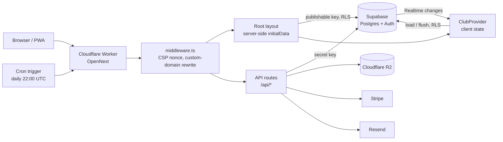

# itsfootball.club

A multi-tenant platform for grassroots football clubs. Anyone can sign up, create a club and get a
complete club website with a live match center, member passes, tournaments, payments and an admin
portal. Each club gets its own branded pages at `itsfootball.club/{club}`, and can also run them on
its own domain.

Built with **Next.js 16 (App Router) + React 19**, **Supabase** (Postgres, Auth, Realtime, Storage),
**Cloudflare Workers** (via OpenNext), **Cloudflare R2**, **Stripe Connect**, **Resend** and Web Push.

---

## Contents

- [Features](#features)
- [Tech stack](#tech-stack)
- [Getting started](#getting-started)
- [Environment variables](#environment-variables)
- [Architecture](#architecture)
- [Security model](#security-model)
- [Project structure](#project-structure)
- [Testing and quality checks](#testing-and-quality-checks)
- [Deployment](#deployment)
- [Further documentation](#further-documentation)

---

## Features

Grassroots clubs usually run on a patchwork of WhatsApp groups, spreadsheets, paper sign-up forms,
bank transfers and a website nobody updates. itsfootball.club replaces that patchwork with one
place. Each feature below is listed with the problem it solves.

### Launch and branding

| Feature | Problem it solves |
| --- | --- |
| **Create a club in minutes** (`/create-club`): guided setup for name, motto, contact details, home ground and colours | Volunteers have no time or budget to build and host a website. Here anyone can launch one for free, without a developer |
| **Per-club branding**: colours, crest, short name and motto applied as CSS variables, with a WCAG contrast check and a kit designer preview | Template sites all look the same, and home-made ones are often unreadable. Every club looks like itself, and text stays legible |
| **Own address and custom domains**: `itsfootball.club/{club}`, or the club's own domain via Cloudflare for SaaS with automatic certificates | Clubs want a professional address but can't manage DNS and SSL. A domain is connected in a few steps and certificates renew on their own |
| **Club directory and "My Clubs"** | People who help at several clubs need one account for all of them, and new players need a way to find a club |

### Public club website (`/{club}`)

| Feature | Problem it solves |
| --- | --- |
| **Hero slider** of pinned matches, events, news and gallery items | The homepage goes stale. The slider puts what is happening now at the top without a redesign |
| **Fixtures, results and a club calendar**, filterable by season | Fans and parents ask "when and where is the next game?" in group chats again and again. The answer is now one link |
| **Squad roster, player stats and a leaderboard** | Player stats live in one coach's notebook. They are now public, always current, and a reason for players to share the site |
| **News, video and a photo gallery**, with a rich-text editor | Club news gets lost in social feeds. It now has a permanent, searchable home |
| **Events and training pages** with RSVP, capacity limits and QR self check-in | Organisers don't know who is coming to training, trials, socials or AGMs, or who actually turned up |
| **Executive committee page** | New members don't know who runs the club or whom to ask |
| **Home ground with a map**, surface, parking and transit notes | Away teams and new parents get lost on matchday |
| **Club Teams** (`/{club}/teams`): first team, reserves, youth and other sides, each with its own page | A club is rarely one team. Each side gets its own squad and fixtures instead of one mixed list |
| **Contact form** that lands in the admin Inbox | Enquiries sent to a personal phone or email go unanswered when that person steps down |
| **Search engine and link-preview ready**: per-page metadata, JSON-LD, sitemap, robots and `llms.txt` | Small clubs are invisible on Google and their shared links look broken. Here they show up properly out of the box |

### Live match center (`/{club}/match/{id}`)

| Feature | Problem it solves |
| --- | --- |
| **Live scoreboard and clock** derived from the referee's clock state, pushed through Supabase Realtime | Fans who can't attend rely on someone texting the score. Now everyone sees the same live score and minute |
| **Goal celebrations, event timeline, match stats and Player of the Match** | A result alone is dull. The story of the match keeps fans engaged |
| **Read-only tactical pitch** with each side's lineup | "Who's playing today?" no longer needs a photo of a whiteboard |
| **Shareable matchday graphics** (result or starting XI) for Instagram and WhatsApp | Making a matchday graphic in a design app takes time every week. It is now one tap |
| **Door QR check-in** for spectators | Clubs have no idea how many people actually come to games |

### Tournaments and cups

| Feature | Problem it solves |
| --- | --- |
| **Knockout, league and group + knockout formats**, including a "Top 3" step-ladder playoff | Running a cup by hand in a spreadsheet is error-prone and hard to share |
| **Seeding, byes, third-place match, penalties, and automatic standings and bracket progression** (`lib/tournament-engine.ts`) | Working out who plays whom next, and who goes through, causes disputes. The engine applies the rules the same way every time |
| **Internal sides and external teams**, plus Player of the Tournament | Clubs run internal cups as well as invitational ones, and want to reward a standout player |

### Members, players and parents

| Feature | Problem it solves |
| --- | --- |
| **Online membership applications** with an approval workflow, tiers and a requested team | Paper forms get lost and details are retyped by hand. Applications now arrive complete and wait for approval |
| **Virtual member pass** with a unique QR code, verified by scanning | Membership cards cost money and get lost. Anyone at the gate can check a member in seconds |
| **Member sign-in** by one-time email link or password, protected by a Turnstile bot check, plus a "claim my memberships" flow | Members forget passwords, and bots abuse sign-up forms. Existing records can be linked to a new account |
| **Matchday availability** (Available, Doubtful, Not Available) by personal link or in the club app, and a public matchday squad | Coaches chase players one by one to find out who can play |
| **Club app** (`/{club}/app`, installable per club): what's coming up, your availability, your pass, and the admin tools your roles allow | Members want one thing on their phone, not a website bookmark plus several chat groups |
| **Guardian accounts**: one parent sign-in for several children, with messages, payments and emails going through the guardian | Parents of junior players had to juggle a separate login per child, and clubs had to email children directly |
| **Junior safeguarding**: junior names masked on public pages, junior scores hidden by default for young age groups, a welfare officer shown on junior team pages, guardian and photo consent on the form | Clubs must protect children's identities and follow youth football guidance without each volunteer remembering the rules |
| **Message the club**: per-member conversations with club administration | Questions sent to a coach's personal number are lost and can't be followed up by someone else |
| **Membership renewal**: year to year from the join date, or by fiscal year from a chosen month, with a grace period | Treasurers lose track of who has paid for this season |
| **ClubScore gamification**: points for attendance, goals, assists, clean sheets and MOTM, with streaks, tiers and badges | Attendance at training drops off during the season. Points and streaks give players a reason to keep turning up |

### Admin portal (`/{club}/admin`)

The admin menu has eight groups, each with sub-menus that link straight to page tabs.

| Group | What it holds | Problem it solves |
| --- | --- | --- |
| **Overview** | Dashboard with search across the club, and the **Inbox** (member messages and contact-form enquiries, with unread counts) | Admins have to check several places to see what needs attention |
| **Matchday** | Player Availability, Lineup Workbench (draft and publish lineups on a tactical pitch), Match Centre controller (score, clock, cards, subs, VAR, penalties, MOTM) and the camera Gate Scanner | Running a match means a clipboard, a WhatsApp poll and someone texting scores. It is now one phone on the touchline |
| **Fixtures & Events** | Fixtures & Results, Tournaments & Cups (with tournament sides), Events & Training (with attendance) | Fixtures, cups and training live in different spreadsheets |
| **Players & Teams** | Squad & Players (CSV import and export), Club Teams, Members (Applications, Active, Rejected) and Committee | The player list, team sheets and membership register drift out of sync |
| **Money** | Finance (income and expense ledger with receipts, payment settings), Club Shop (orders and products) and Sponsors (list and sponsor report) | The treasurer reconciles bank statements, receipts and merch orders by hand |
| **Club Content** | News, Photo Gallery and Homepage Slider | Updating the website needs "the one person who knows how" |
| **Fans & Engagement** | Email Notifications, ClubScore and Website Analytics (page views, gate scans, sponsor performance) | The club can't tell whether anyone reads its site, and sponsors ask for proof their money is seen |
| **Club Settings** | Club Profile & Branding (including custom domain), Seasons, Junior & Safeguarding, and Roles & Permissions | Settings are scattered, and everyone ends up with full admin access because nothing finer exists |

**Roles and permissions.** Default access roles (Treasurer, Manager, Youth Coach, Secretary, Welfare
Officer, Media Officer, Commercial Officer, Volunteer) give each person only the admin areas they need,
at view, edit or full level. Clubs can add their own roles. This solves the problem of handing every
volunteer the keys to everything, including finances and children's data. See [Roles](#roles).

### Payments and commerce

| Feature | Problem it solves |
| --- | --- |
| **Stripe Connect**: each club connects its own Stripe account, with an optional platform booking fee | Collecting fees in cash or by chasing bank transfers is slow, and money must go straight to the club, not through a third party |
| **Paid memberships, event tickets and shop orders**, with ticket pages per order (`/{club}/tickets/{orderId}`) | Selling tickets or kit means a separate shop tool and manual lists of who has paid |
| **Bank transfer with receipt upload** | Many members still prefer bank transfer. The receipt is attached to the payment so the treasurer can check it |

### Communications

| Feature | Problem it solves |
| --- | --- |
| **Branded club emails** through Resend: sign-in links, daily match, event and renewal reminders, and admin notices, with one-click unsubscribe | Reminders are sent by hand, or not at all, and generic emails look like spam |
| **Web push notifications** to followers when the club sends a notice (installable PWA with an offline page) | Important notices get buried in busy group chats. Push puts them on followers' phones directly |
| **Calendar feed** (`/{club}/calendar.ics`, subscribable via `webcal://`) | Families have to copy fixtures into their own calendars by hand, and miss changes |

### Platform qualities

| Quality | Problem it solves |
| --- | --- |
| **Mobile-first**, with light and dark themes and reduced-motion support | Most people use the site on a phone at the side of a pitch |
| **Real-time and always from the database**: data comes from Supabase and live changes are pushed to every open page | Different people see different, outdated versions of the same information |
| **Security by default**: Row Level Security on every table, public-safe views, a strict CSP and verified webhooks | Clubs hold personal data about adults and children but have no security staff. See [Security model](#security-model) |

---

## Tech stack

| Layer | Technology |
| --- | --- |
| Framework | Next.js 16 (App Router), React 19, TypeScript |
| Hosting | Cloudflare Workers via [`@opennextjs/cloudflare`](https://opennext.js.org/cloudflare) |
| Database and auth | Supabase: Postgres with Row Level Security, Auth, Realtime, Storage |
| File storage | Cloudflare R2 through the S3 API (falls back to Supabase Storage) |
| Payments | Stripe Connect |
| Email | Resend (including the Supabase Auth send-email hook) |
| Push | Web Push (VAPID) with a service worker |
| UI | Hand-written CSS (`app/globals.css`), `lucide-react` icons, `canvas-confetti`, `qrcode.react`, `html5-qrcode` |

---

## Getting started

### Prerequisites
- **Node.js 20+** and npm
- A **Supabase** project (the free tier is fine for development)
- Optional, depending on which features you need: Cloudflare R2, Stripe, Resend, and a Cloudflare account for deployment

### 1. Install

```bash
git clone <repo-url> itsfootball.club
cd itsfootball.club
npm install
```

### 2. Configure environment

```bash
cp .env.example .env.local
```

At minimum, fill in the Supabase values (`NEXT_PUBLIC_SUPABASE_URL`, `NEXT_PUBLIC_SUPABASE_PUBLISHABLE_KEY`
and `SUPABASE_SECRET_KEY`). Everything else enables optional features; see
[Environment variables](#environment-variables).

### 3. Set up the database

The schema lives in `supabase/migrations/`. Running every file **in filename order** builds a fresh
database. The migrations are written to be idempotent (`IF NOT EXISTS`, `DROP ... IF EXISTS`), so
re-running them is safe.

Use one of these:

- **Supabase SQL editor:** paste and run each file in order, starting with `20260918_base_schema.sql`.
- **psql** (connection string from Supabase → Project Settings → Database):

  ```bash
  for f in supabase/migrations/*.sql; do psql "$DATABASE_URL" -v ON_ERROR_STOP=1 -f "$f"; done
  ```

The migrations also create the Storage buckets (`club-assets` for public uploads and `receipts` for
private payment receipts), the RLS policies, the public-safe views and the Realtime publication.

### 4. Configure Supabase Auth

In Supabase → **Authentication → URL Configuration**, set the Site URL to your app's URL
(`http://localhost:3000` for local development) and add `http://localhost:3000/**` to Redirect URLs.

For local development, Supabase's built-in emails are enough. In production, switch on the
**Send Email hook** so sign-in emails are club-branded and sent through Resend; see
[docs/email.md](docs/email.md).

### 5. Run

```bash
npm run dev
```

Open <http://localhost:3000>, create an account and create your first club. Its public site is at
`/{your-club-slug}` and its admin portal is at `/{your-club-slug}/admin`.

---

## Environment variables

`.env.example` documents every variable. The table below shows which ones each feature needs.

| Variable | Needed for | Notes |
| --- | --- | --- |
| `NEXT_PUBLIC_SUPABASE_URL` | **Required** | Also scopes the Content Security Policy to your Supabase host |
| `NEXT_PUBLIC_SUPABASE_PUBLISHABLE_KEY` | **Required** | Browser-safe key. `NEXT_PUBLIC_SUPABASE_ANON_KEY` is accepted as a legacy fallback |
| `SUPABASE_SECRET_KEY` | **Required** for server routes | Server only, never exposed to the browser. Used by payments, uploads, webhooks, cron, email and push. `SUPABASE_SERVICE_ROLE_KEY` is a legacy fallback |
| `NEXT_PUBLIC_SITE_URL` | Self-hosting on another domain | Canonical platform URL; defaults to `https://itsfootball.club` |
| `R2_ACCOUNT_ID`, `R2_ACCESS_KEY_ID`, `R2_SECRET_ACCESS_KEY`, `R2_BUCKET_NAME`, `R2_PUBLIC_DOMAIN` | Image and video uploads on R2 | If unset, uploads go to the Supabase `club-assets` bucket |
| `R2_PRIVATE_BUCKET` | Private receipts on R2 | If unset, receipts go to the Supabase `receipts` bucket |
| `STRIPE_SECRET_KEY`, `STRIPE_CONNECT_WEBHOOK_SECRET` | Card payments | The Connect webhook points at `/api/stripe/webhook`; the required events are listed in `.env.example` |
| `NEXT_PUBLIC_BOOKING_FEE_PERCENT`, `_FLAT_CENTS`, `_MIN_CENTS` | Platform booking fee | Leave empty for no fee |
| `RESEND_API_KEY`, `EMAIL_FROM_ADDRESS`, `SEND_EMAIL_HOOK_SECRET`, `SUPPORT_EMAIL`, `EMAIL_TIMEZONE` | Email | See [docs/email.md](docs/email.md) |
| `CRON_SECRET` | Daily reminders and unsubscribe links | Long random string; changing it invalidates existing unsubscribe links |
| `CF_HOSTNAMES_TOKEN`, `CF_ZONE_ID` | Club custom domains | See [docs/custom-domains.md](docs/custom-domains.md) |
| `NEXT_PUBLIC_VAPID_PUBLIC_KEY`, `VAPID_PRIVATE_KEY`, `VAPID_SUBJECT` | Web push | Generate the pair once (command in `.env.example`); rotating it breaks every existing subscription |
| `NEXT_PUBLIC_TURNSTILE_SITE_KEY` | Bot check on sign-in, sign-up, magic links and password resets | Put the matching secret in Supabase (Authentication > Attack Protection > CAPTCHA, provider Turnstile). Switch that on only after a build with the site key is live |

> **Build-time values:** `NEXT_PUBLIC_*` variables, `R2_PUBLIC_DOMAIN` and the Supabase URL are baked
> into the build (the CSP is computed in `next.config.ts`). Rebuild and redeploy after changing them.

---

## Architecture

### High-level overview



**How the pieces fit together**

1. **People.** Three kinds of user reach the same app: visitors read the public club site, members
   and parents use their pass, availability and the club app, and admins run the club from the admin
   portal. What each one sees is decided by their sign-in and their club role.
2. **Cloudflare edge.** Every request goes to one Cloudflare Worker running the Next.js app (built
   with OpenNext). A club can use its own domain through Cloudflare for SaaS; `middleware.ts` maps
   that domain to the club's slug, so `yourclub.com/member` serves `/{slug}/member`. The middleware
   also sets a per-request CSP nonce.
3. **Pages.** The root layout loads the club's public data on the server, so the first HTML already
   contains real content for search engines and fast loading. In the browser, `ClubProvider` keeps the
   club's data in memory, reads and writes Supabase directly with the browser-safe publishable key, and
   subscribes to Supabase Realtime, so a goal logged in the Match Centre appears on every open page
   within moments.
4. **Supabase is the source of truth.** Postgres holds every club's data, keyed by `club_id`. Row
   Level Security decides what each user may read or write, so a bug in the UI cannot leak another
   club's data or a member's private details. Visitors read sensitive tables only through public-safe
   views. Supabase Auth handles sign-in (email link or password), protected by a Turnstile bot check.
5. **API routes for privileged work.** Anything needing a secret runs in `app/api/*` on the Worker,
   after checking the caller's session and role: card payments and Stripe webhooks, file uploads to R2
   (falling back to Supabase Storage), branded emails through Resend (including Supabase's sign-in
   emails via the send-email hook), web push, custom domain setup and the account and contact endpoints.
6. **Scheduled jobs.** A Cloudflare cron trigger fires once a day and calls the reminders route,
   which sends availability, event and renewal reminders, each at most once.

The diagram below zooms in on a single request.

### Request flow



### Key design decisions

**Multi-tenancy by URL.** Every club lives under `/{clubSlug}`, and all tenant data carries a
`club_id`. `middleware.ts` maps a club's custom domain to its slug, with a 60-second per-isolate
cache, and rewrites `yourclub.com/member` to `/{slug}/member`. Platform-only pages on a club domain
redirect back to the main site. Old slugs keep working through `previous_slugs`.

**Server-rendered first paint, client-side state after.** For each request the root layout loads the
club's public data on the server (`lib/supabase/server-data.ts`, cached per request, with a 3-second
timeout). It passes that to `ClubProvider` as `initialData`, so pages render real content into the
first HTML for search engines and fast paints. In the browser, `lib/club-context.tsx` holds the app
state as in-memory arrays, caches it in `localStorage`, reloads from Supabase and subscribes to
Realtime changes.

**One sync engine for writes.** Pages edit state through context actions. `lib/supabase/sync.ts`
diffs the current arrays against what is known to be in the database, then upserts only the changed
columns, parents first. Rows are deleted only when deletion is explicitly requested. The column
whitelist is `lib/supabase/columns.ts`. Row Level Security decides what each user may actually write.

**Privileged work in API routes.** Anything that needs a secret runs in `app/api/*` with the Supabase
secret key, after checking the caller's session and role: payments, uploads, webhooks, emails, push,
custom domains and cron.

**Pure engines with self-checks.** Domain logic that is easy to get wrong lives in plain TypeScript
modules with runnable assertion files beside them, rather than inside components. Examples are the
tournament engine, finance, tickets, shop, slugs and push. See
[Testing and quality checks](#testing-and-quality-checks).

**Scheduled jobs.** `worker.ts` wraps the OpenNext worker and adds a Cloudflare cron trigger
(`wrangler.json`). Each day it calls `/api/cron/reminders`, authenticated with `CRON_SECRET`, to send
availability, event and renewal reminders. Each email is sent at most once (`email_log`).

### Roles

| Role | Can do |
| --- | --- |
| Owner (`clubs.owner_id`) | Everything for their club, including billing (Stripe Connect), custom domain and ownership-level settings |
| Club Admin (super user) | Every admin area, plus creating access roles, setting their permissions and deciding who holds them |
| Access roles (Treasurer, Manager, Youth Coach, Secretary, Welfare Officer, Media Officer, Commercial Officer, Volunteer, or the club's own) | The admin areas their role allows, each at view, edit (create and change) or full (also delete) |
| `player`, `member`, `supporter` | Member features: pass, availability, ClubScore. What they can see is limited by RLS |
| Visitor (signed out) | Public pages only, read through public-safe views |

Every club starts with the default access roles above (`club_access_roles`); a Club Admin edits them or
adds new ones on **Admin → Roles & Permissions**. A member holds a role by carrying its name as a squad
label (Squad & Players page), and several roles combine to the highest level per area. Only the Owner or
a Club Admin can give or remove access roles.

The UI hides admin pages by permission (`AdminGuard`, `useAuth().can`), but **the database is the
authority**: RLS policies use `has_club_perm(club_id, areas, level)`, and `is_club_admin(club_id)` for
super-user actions. Area keys live in `lib/permissions.ts`.

---

## Security model

- **Row Level Security on every table.** Public pages read sensitive tables only through public-safe
  views: `club_members_public` (no email, phone, date of birth or emergency contact),
  `player_availabilities_public` (only "available", without notes or response tokens) and `sponsors_public`.
- **Secrets stay on the server.** Only `NEXT_PUBLIC_*` values reach the browser. The Supabase secret
  key, Stripe, R2, Resend, VAPID and Cloudflare tokens are used only in API routes.
- **Strict CSP with a per-request nonce** (`middleware.ts` + `next.config.ts`): `'strict-dynamic'`
  scripts, allow-listed image, media and connect origins scoped to your own Supabase and R2,
  `frame-ancestors 'self'` and `object-src 'none'`. The site also sends `X-Frame-Options`,
  `X-Content-Type-Options`, `Referrer-Policy` and `Permissions-Policy`.
- **Verified webhooks.** Stripe signatures and the Supabase send-email hook signature are checked
  before acting. Unsubscribe links are HMAC-signed.
- **Upload validation.** File types are checked by their actual bytes (`lib/file-signature.ts`), not
  by the name or claimed type. Rich text is sanitised with DOMPurify.
- **Abuse limits.** API routes are rate-limited (`lib/rate-limit.ts`, best effort per isolate),
  backed by database-side limits on contact forms and analytics inserts.
- **Tenant isolation in the UI as well.** Pages only show records belonging to the club in the URL,
  never "the first club" or another club's cached data.

Report security issues privately to the maintainers rather than in a public issue.

---

## Project structure

```text
app/
  [clubSlug]/              Club site: home, match, events, tournaments, member, shop, tickets, ...
    admin/                 Club admin portal (one folder per section)
    @schema/               Parallel route that renders JSON-LD on the server
    calendar.ics/          Calendar feed
  api/                     Server routes (payments, upload, stripe, cron, email, push, custom-domain, ...)
  clubs/ create-club/ my-clubs/ faq/ auth/ unsubscribe/   Platform pages
  layout.tsx               Root layout: loads initialData, providers, fonts
  sitemap.ts robots.ts manifest.webmanifest/
components/                Shared UI (TacticalPitch, ScoreboardDigitRoll, VirtualPassCard, tournament/*, ...)
lib/
  club-context.tsx         Client app state, Realtime and cache (ClubProvider / useClub)
  auth-context.tsx         Supabase Auth session and per-club roles
  supabase/                Clients, sync engine, server data loader, types, column whitelist
  tournament-engine.ts     Fixtures, brackets, standings, match-side helpers
  email/ storage/          Resend templates and sender; R2 and receipts storage
  *.check.ts               Self-check scripts (see below)
supabase/migrations/       Database schema, RLS, views, functions (run in filename order)
public/                    Service worker, offline page, icons, llms.txt
docs/                      Setup guides for email and custom domains
middleware.ts              CSP nonce and custom-domain routing
worker.ts / wrangler.json  Cloudflare Worker entry and cron trigger
```

---

## Testing and quality checks

```bash
npm run check          # Runs every lib/*.check.ts self-check (tournament engine, finance, shop, tickets, ...)
npm run lint           # ESLint (next/core-web-vitals + next/typescript)
npx tsc --noEmit       # Type check
```

The `*.check.ts` files are small assertion scripts bundled with esbuild and run in Node, with no test
framework. When you change one of those modules, add a case to its check file. Run a single one with:

```bash
npx esbuild lib/tournament-engine.check.ts --bundle --platform=node --log-level=warning | node
```

UI changes should be checked in a browser at phone widths (320 and 360px) as well as on desktop, in
both light and dark themes.

---

## Deployment

The app is deployed to **Cloudflare Workers** with OpenNext.

```bash
npm run build:cloudflare      # next build + OpenNext transform into .open-next/
npx wrangler deploy           # deploys worker.ts with the assets and the cron trigger
```

1. **Build-time variables:** make the `NEXT_PUBLIC_*` values, `NEXT_PUBLIC_SUPABASE_URL` and
   `R2_PUBLIC_DOMAIN` available in the environment when you run the build.
2. **Runtime secrets:** set each server secret with `npx wrangler secret put NAME`. Plain variables
   added in the Cloudflare dashboard are wiped by the next `wrangler deploy`.
3. **Cron:** `wrangler.json` schedules `0 22 * * *` (UTC) for the daily reminders. Set `CRON_SECRET`.
4. **Stripe:** create a Connect webhook ("Events on connected accounts") pointing at
   `https://<your-domain>/api/stripe/webhook` with the events listed in `.env.example`.
5. **Email and custom domains:** follow [docs/email.md](docs/email.md) and
   [docs/custom-domains.md](docs/custom-domains.md).
6. **Database:** apply any new files in `supabase/migrations/` before deploying code that depends on them.

---

## Further documentation

| Document | What it covers |
| --- | --- |
| [docs/email.md](docs/email.md) | Resend domain verification, the Supabase send-email hook, reminders, unsubscribe |
| [docs/custom-domains.md](docs/custom-domains.md) | Cloudflare for SaaS setup and how club domains are routed and signed in |
| [.env.example](.env.example) | Every environment variable, with setup notes |
| [plans/](plans/README.md) | Implementation plans for UI and animation improvements |
| `graphify-out/` | Generated knowledge graph of the codebase (`graphify query "<question>"`); refresh with `graphify update .` |
